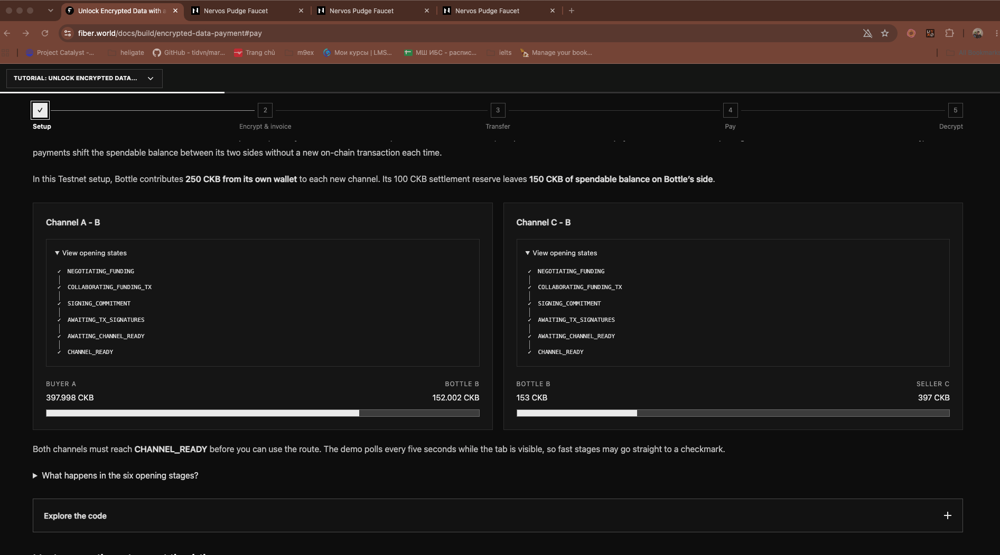
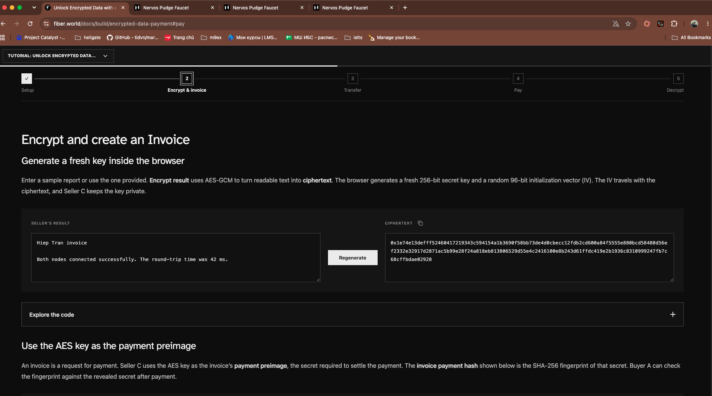
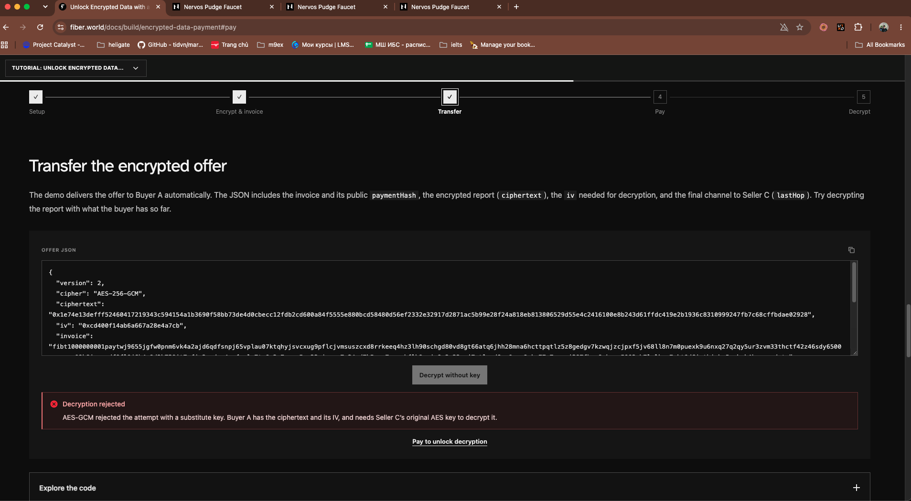
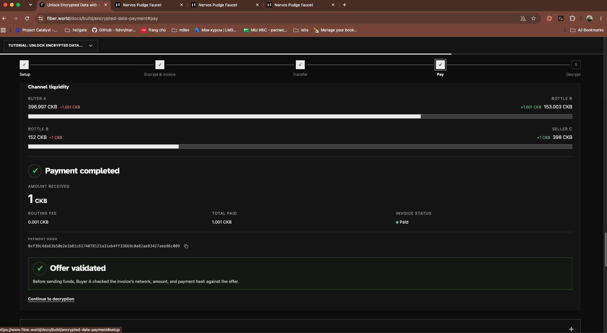
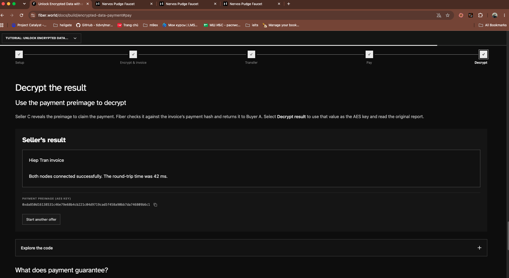

# Quest 1 (Basic) proof screenshots

Screenshots from the Fiber tutorial [Unlock Encrypted Data with a Fiber Payment](https://www.fiber.world/docs/build/encrypted-data-payment), run on CKB Testnet. All five belong to the same offer.

Payment hash of the offer: `0xf39c4da63b50e2e1b81c6174078121a31eb4ff33669c0a82ae83427aee96c009`

| # | File | What it shows |
|---|---|---|
| 1 | [01-channels-ready.png](01-channels-ready.png) | Setup: Channel A–B and Channel C–B both reached `CHANNEL_READY` |
| 2 | [02-encrypt-ciphertext.png](02-encrypt-ciphertext.png) | Seller's text encrypted with AES-GCM; ciphertext generated in the browser |
| 3 | [03-offer-decryption-rejected.png](03-offer-decryption-rejected.png) | Before payment: encrypted offer on the buyer side and the **Decryption rejected** message |
| 4 | [04-payment-receipt.png](04-payment-receipt.png) | After payment: completed receipt, **1 CKB** payment, routing fee 0.001 CKB, with the payment hash |
| 5 | [05-decrypted-result.png](05-decrypted-result.png) | After decryption: the revealed preimage (AES key) and the seller's original text |

Consistency check: the SHA-256 of the preimage shown in screenshot 5 equals the payment hash shown in screenshot 4, and the ciphertext in screenshot 2 is the one in the offer in screenshot 3.

